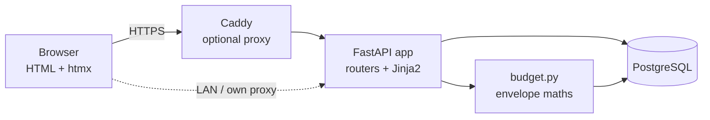

# Zerobase Task Tracking

This document tracks all tasks for the Zerobase project. Each task has a unique ID and corresponding detailed task file alongside this index in the `TASKS/` folder.

---

## Project Overview

**Brief Description**: A self-hosted, web-based zero-based (envelope) budgeting app in the spirit of YNAB. Every pound gets a job: income lands in Ready to Assign, is assigned to categories month by month, and spending draws those envelopes down. Runs in Docker on your own hardware with your data in your own PostgreSQL.

### Tech Stack
- **Operating System**: Any Docker host (target: Debian/Ubuntu VM or LXC on Proxmox)
- **Primary Language**: Python 3.12 (3.11+ supported)
- **Framework**: FastAPI with server-rendered Jinja2 templates and htmx (vendored, no build step, no CDN)
- **Database**: PostgreSQL 16 in production, SQLite for tests and local dev
- **Other Key Technologies**: SQLAlchemy 2, argon2-cffi, Starlette signed sessions, Docker Compose, optional Caddy reverse proxy, GitHub Actions CI (tests on SQLite and PostgreSQL)

### Architecture

**Note**:
- All money is stored as signed integers in minor units (pence). Never floats.
- Every row carries `user_id` and every query is scoped to the signed-in user.
- Budget numbers are computed on read from transactions and assignments (`budget.build_budget`); nothing derived is stored. Today, income is identified by convention: an on-budget transaction with no category and a positive amount.
- Strict CSP (`default-src 'self'`): no inline scripts, no third-party assets. Any JS or chart library must be vendored.
- Schema changes go through Alembic migrations (`src/zerobase/migrations/`); the app upgrades the database to head on startup. Every model change needs a new revision.

---

## Task Management System

### Task ID Format

`TASK-[Priority][Number]`

**Priority Prefix**:
- `C` - Critical
- `H` - High
- `M` - Medium
- `L` - Low

**Number**: Sequential 3-digit number within priority level

### Priority Definitions

| Priority | Description | Examples |
|----------|-------------|----------|
| **C - Critical** | MVP blockers, production issues, dependencies blocking other tasks | Security vulnerabilities, data-loss risks, blocking infrastructure |
| **H - High** | MVP features, core functionality | Features needed before real day-to-day budgeting |
| **M - Medium** | Enhancements, important but not critical features | Goals, reports, hardening |
| **L - Low** | Nice-to-have, polish | UX polish, exports |

### Effort Estimates

| Effort | Time Estimate | Description |
|--------|---------------|-------------|
| **S** | 1-2 days | Small changes, bug fixes, config updates |
| **M** | 3-5 days | Moderate features, integrations, refactoring |
| **L** | 1-2 weeks | Major features, complex integrations |
| **XL** | 2+ weeks | Architecture changes, multiple integrations |

### Status Values

| Status | Meaning |
|--------|---------|
| **TODO** | Available for assignment, ready to start |
| **IN_PROGRESS** | Currently being worked on |
| **BLOCKED** | Waiting on dependency or external issue |
| **REVIEW** | Complete, awaiting review/testing |
| **DONE** | Fully complete and integrated |

### Branch Naming Convention

Each task is worked on in its own Git branch named after the task ID (e.g. `TASK-C001`, `TASK-H002`).

### Task Files

Each task has a corresponding detailed document in the `TASKS/` folder:
- Filename format: `TASK-[ID].md` (e.g., `TASK-H001.md`)
- Use `TASKS/TASK_TEMPLATE.md` as the basis for new task files

### Source of Truth

Task state lives in two places, and duplicated state drifts. The rule:

- **The task file (`TASKS/TASK-[ID].md`) is the source of truth.** The tables in this document are an *index*: a convenience view, never the authority.
- Any change to a task's status, assignee, or dependencies MUST update both the task file and the index table **in the same commit**. A commit that updates one without the other is incomplete.
- On any disagreement between table and task file, the task file wins, and the discrepancy gets fixed immediately, before other work on that task proceeds.

---

## Critical Priority Tasks

| Task ID | Title | Effort | Status | Assignee | Dependencies | Description |
|---------|-------|--------|--------|----------|--------------|-------------|

---

## High Priority Tasks

| Task ID | Title | Effort | Status | Assignee | Dependencies | Description |
|---------|-------|--------|--------|----------|--------------|-------------|
| TASK-H001 | Edit transactions | S | TODO | Unassigned | None | Edit date, account, payee, memo, category and amount of an existing transaction |
| TASK-H002 | Transfers between accounts | M | TODO | Unassigned | TASK-C001 | Linked two-legged transfers that don't count as income or spending between budget accounts |
| TASK-H003 | Manage categories and groups | M | TODO | Unassigned | TASK-C001 | Rename, reorder, move, hide and delete (with reassignment) categories and groups |
| TASK-H004 | Manage accounts | S | TODO | Unassigned | TASK-C001 | Rename, close/reopen and delete accounts |
| TASK-H005 | Credit card accounts | L | TODO | Unassigned | TASK-C001, TASK-H002 | YNAB-style credit cards with an automatic payment category |
| TASK-H006 | CSV import | L | TODO | Unassigned | TASK-C001 | Import bank statements from CSV with column mapping, preview and duplicate detection |

---

## Medium Priority Tasks

| Task ID | Title | Effort | Status | Assignee | Dependencies | Description |
|---------|-------|--------|--------|----------|--------------|-------------|
| TASK-M001 | Targets and goals | L | TODO | Unassigned | TASK-C001 | Per-category targets with underfunded amounts and quick-assign |
| TASK-M002 | Scheduled and recurring transactions | L | TODO | Unassigned | TASK-C001 | Repeating transactions that are entered automatically when due |
| TASK-M003 | Spending and net-worth reports | M | TODO | Unassigned | TASK-H002 | Spending by category over time, income vs spending, net worth |
| TASK-M004 | Trusted-proxy support for client addresses | S | TODO | Unassigned | None | Use the real client IP behind Caddy or another proxy so login throttling works per client |
| TASK-M005 | Transaction list paging and search | S | TODO | Unassigned | None | Remove the silent 200-row cap; add paging and filters |
| TASK-M006 | Cleared status and reconciliation | M | TODO | Unassigned | TASK-C001, TASK-H001 | Mark transactions cleared and reconcile accounts against the bank balance |

---

## Low Priority Tasks

| Task ID | Title | Effort | Status | Assignee | Dependencies | Description |
|---------|-------|--------|--------|----------|--------------|-------------|
| TASK-L001 | Form validation loose ends | S | TODO | Unassigned | None | Friendly errors where forms currently fail silently or return a bare 404 |
| TASK-L002 | Data export | S | TODO | Unassigned | None | Download your transactions and budget as CSV |

---

## Completed Tasks Archive

| Task ID | Title | Effort | Completed | Assignee | Description |
|---------|-------|--------|-----------|----------|-------------|
| TASK-C001 | Database migrations (Alembic) | M | 2026-10-21 | Claude | Versioned Alembic migrations applied on startup; refuses pre-migration databases |
| TASK-H000 | Initial scaffold | M | 2026-10-19 | Claude | FastAPI app, envelope maths, auth, accounts, transactions, Docker, CI |

---

*Last Updated: 2026-10-21*

## Quick Reference

**To add a new task**:
1. Determine priority and assign next sequential number for that priority
2. Add row to appropriate priority table above
3. Create detailed task file using `TASKS/TASK_TEMPLATE.md`
4. Create git branch with task ID name

**To update a task**:
1. Update the detailed task file (source of truth) with progress
2. Update status/assignee/other fields in the index table above, in the same commit
3. Update "Last Updated" timestamp

**To complete a task**:
1. Change status to DONE
2. Complete all sections in task file
3. Move task row to "Completed Tasks Archive" section
4. Note completion date
